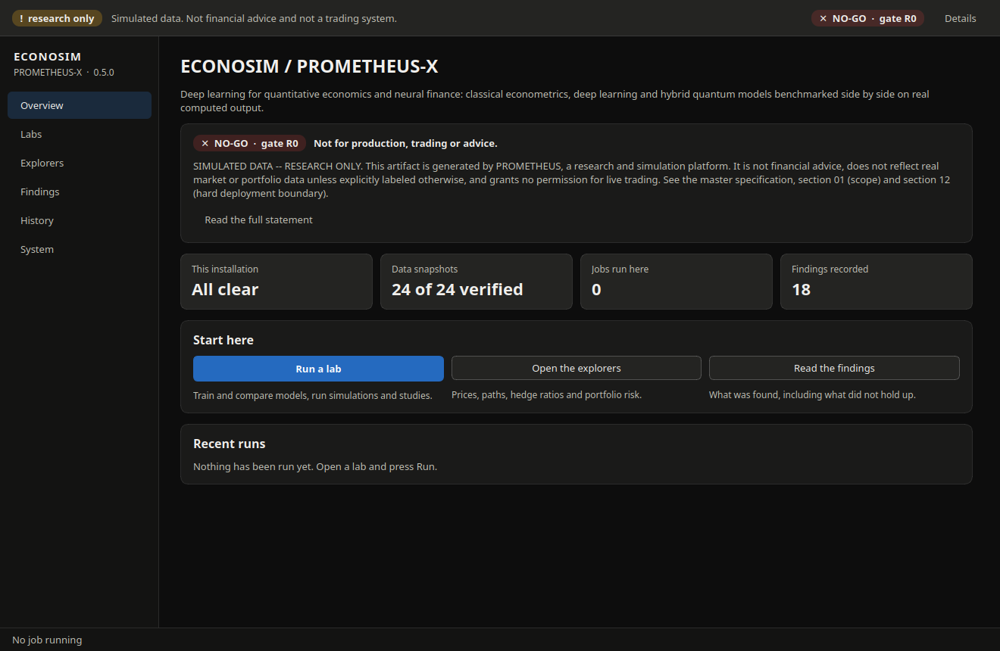
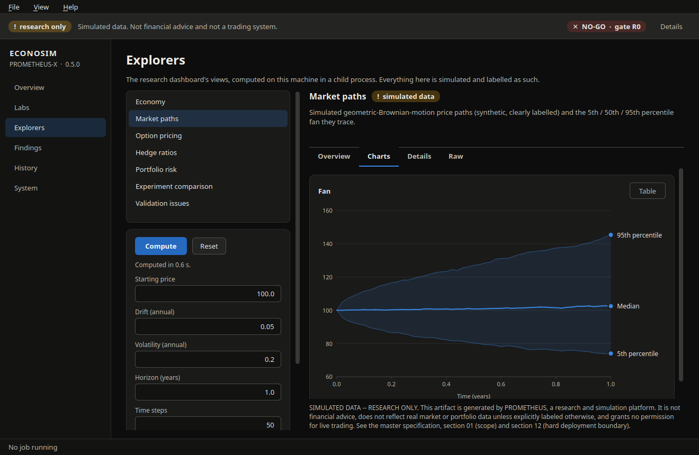

# ECONOSIM

**A research platform for computational economics, stochastic finance, and neural risk control.**

[](./docs/PR_LEDGER.md)
[](./CHANGELOG.md)
[](./CHECKLIST_STATUS.md)
[-blue)](./CHECKLIST_STATUS.md)
[](./LICENSE)
[](./pyproject.toml)

> **Research and simulation only.** Nothing in this repository is financial
> advice, a trading system, or infrastructure for live trading. See
> [Status & disclaimers](#status--disclaimers).

---

## Overview

**Beyond Model Complexity: An Empirical Evaluation of Classical, Deep
Learning, and Hybrid Quantum Models for Quantitative Economic and
Financial Tasks.** ECONOSIM (formerly PROMETHEUS) is a from-scratch
research platform that puts that question to real data, with a hard
rule attached: nothing counts as a finding here unless a specific,
reproducible, currently-passing test produced it. It combines six
subsystems behind that one evidence discipline:

- **a multi-agent computational economy** — households, firms, banks and a
  government, wired to a real double-entry ledger, with point-in-time data
  access, deterministic shocks, a macro time engine, and a PPO-trained
  multi-agent reinforcement-learning policy benchmarked against the
  deterministic/calibrated baseline;
- **classical and stochastic-volatility market models** — GBM, Heston,
  Merton jump-diffusion, regime-switching, with Monte Carlo and
  closed-form pricers for European, American, barrier and Asian options,
  plus a neural SDE trained on real macro data and benchmarked against
  classical baselines with proper scoring rules and real-event OOD
  evaluation;
- **neural PDE/BSDE option-pricing solvers** — PINN and deep-BSDE
  solvers for the Black-Scholes PDE, benchmarked against the classical
  Crank-Nicolson grid and the closed-form price for accuracy, speed, and
  the dimensionality crossover where a grid stops being practical;
- **institutional risk analytics** — VaR, Expected Shortfall, factor
  exposure, stress testing, portfolio optimization and covariance
  shrinkage;
- **deep hedging and decision infrastructure** — a CVaR-trained neural
  hedging policy benchmarked against classical baselines, plus the audit,
  provenance, and model-lifecycle tooling needed to make any of the above
  trustworthy evidence rather than a demo; and
- **a real, authenticated research dashboard and a unified React
  frontend** — a separate ASGI service (`python -m prometheus.dashboard
  serve`, or `econosim dashboard serve` once installed — see
  [below](#cli)) and a Vite + React + TypeScript app (`frontend/`) rendering
  live computed output from every subsystem above, with owner-scoped
  portfolio access and real HTTP authorization boundaries, not a mockup.
  `./run_dev.sh` starts the whole stack with one command; see
  [frontend/README.md](./frontend/README.md). `docker compose up --build`
  runs the already-built artifact with nothing installed locally but
  Docker, via a `prometheus.webgateway` reverse-proxy service -- which is
  also the deployment's hardened edge: a closed request-target grammar,
  per-client rate limiting, bounded bodies, security headers and a
  Content-Security-Policy with no third-party origin (see
  [SECURITY.md](./SECURITY.md) and
  [docs/THREAT_MODEL.md](./docs/THREAT_MODEL.md)). The project's NO-GO
  gate for live trading is unchanged by any of it. The container runs as an
  unprivileged user with a read-only root, no capabilities and health checks, bound to
  loopback by default, with a real TLS overlay; [docs/DEPLOYMENT.md](./docs/DEPLOYMENT.md)
  is the operator's guide, including what the deployment does NOT give you. Every committed data
  snapshot is verified against `data_cache/MANIFEST.sha256.json` whenever a loader reads it, the parsers for
  third-party data are fuzzed, and a pre-commit hook plus a whole-repository test refuse secrets
  (see [SECURITY.md](./SECURITY.md)).

The project is built against two governing specifications — the original
[374-item master blueprint](./docs/PROMETHEUS_Quantitative_Economics_Full_Master_Blueprint.pdf)
and the [PROMETHEUS-X final-project addendum](./docs/PROMETHEUS_X_Final_Project_Integrated_Blueprint.md)
— and tracks its own progress against both, honestly, in public.

## Key findings

Five falsifiable hypotheses were frozen on 2026-11-11 against the
evidence gathered through that date — see
[docs/FINAL_PROJECT_HYPOTHESES.md](./docs/FINAL_PROJECT_HYPOTHESES.md)
for the full, retrospectively-frozen record and its own honest caveat
about what that means for evidentiary weight. After that date the
questions don't change; the evidence for or against them can, with
every revision disclosed. The pattern across all five, and across
the two newer, not-yet-frozen findings below: **the more complex
method winning was the exception, not the rule** — and the exceptions
that did appear were earned by ruling out confounds directly, not by
re-running until a result looked good.

| ID | Question | Verdict |
|---|---|---|
| **H1** | Does a hybrid quantum-classical model beat classical baselines on recession classification / factor regression? | **Rejected.** Tested 3 independent ways (2 real datasets, 2 task families); every bootstrap CI includes zero. |
| **H2** | Does a neural SDE beat classical baselines in-distribution, and degrade less under a real shock? | **Partially supported.** Not better in-distribution — but genuinely more robust under the real 2020 COVID shock (+6.99 vs. a GBM baseline's +26.45 log-score degradation). |
| **H3** | Does a neural PDE solver (PINN/deep-BSDE) earn its cost over a classical grid at high dimension? | **Supported**, crossover measured not assumed — revised 2026-11-13 once an undertrained baseline was caught and fixed (grid's accuracy edge over deep-BSDE: ~580x → ~2x; verdict unchanged). |
| **H4** | Can naive fixed-epoch training or an unaudited reward silently produce a false conclusion? | **Supported, twice**, independently (RECESSIONNET's early-stopping fix; MARL's reward-design fix). |
| **H5** | Does a REINFORCE hedging agent beat a well-specified static baseline? | **Rejected.** Still loses after fixing a real reward/metric mismatch and training 10–20x longer (gap narrowed ~2.5x → ~1.04–1.41x, still a loss). |

Two further checks, run after the freeze (disclosed as such, not
folded into H1–H5): a textbook recession predictor (the US Treasury
10Y-3M yield-curve spread) was added to RECESSIONNET as a real feature
and made things **worse**, not better (ROC-AUC 0.71–0.85 without it vs.
0.35–0.83 with it, across the same 5 seeds) — plausibly because an
already data-starved model gained one more dimension to fit. And a
"train harder" pass across all seven deep-learning subsystems found
two defaults were already *correct*: the neural SDE's one clearly
positive result (above) collapses under more training, and
the Brier-score-vs-ROC-AUC trap on RECESSIONNET's Kaggle data is real
(an inverted ranking at one seed that only a second diagnostic exposes),
but its first, 'seed 0' form turned out to be partly a data look-ahead we
then found and fixed (Finding 13). See
[docs/RESULTS_AND_LIMITATIONS.md](./docs/RESULTS_AND_LIMITATIONS.md)
(18 numbered findings, each with its own re-runnable test) and
[docs/RESEARCH_CONTRIBUTIONS.md](./docs/RESEARCH_CONTRIBUTIONS.md) for
the full account behind every line above, or
[docs/FINAL_PAPER.md](./docs/FINAL_PAPER.md) for all of it assembled
into one linear final-project paper, limitations and null/negative
experiments included by name.

## The evidence discipline

**"Evidenced" means exactly one thing here: a passing automated test in
this repository links to that specific checklist item.** Not a design
document, not a docstring, not a plan — a test that runs today, cross-checked
against a closed-form, an independent numerical method, or real data
wherever one exists, with `ruff` and `mypy --strict` clean on every touched
module. Nothing is marked done on the strength of a specification alone,
and every PR states plainly what it does *not* cover.

| | |
|---|---|
| Blueprint items evidenced | **361 / 374** (96.5%) across 29 categories |
| Categories at 100% | API, AUD, CIQ, DOC, DRI, ECO, EXP, GOV, HDG, LCH, LED, MAR, MLO, NSD, OPS, OPT, PDE, PRI, REL, RISK, SDE, UIX, VAL |
| Test suite | **4,832 / 4,832** passing, 12 skipped by design (Python, `uv run pytest -q`); **21 / 21** passing (`frontend/`'s separate Vitest suite) |
| Lint & types | `ruff` clean, `mypy --strict` clean |
| Pull requests | 205, each independently verified |

For the full per-category breakdown, see [CHECKLIST_STATUS.md](./CHECKLIST_STATUS.md).
For the detailed, PR-by-PR account of what was built and how each claim
was verified, see [docs/PR_LEDGER.md](./docs/PR_LEDGER.md). For a shorter,
human-curated summary of what changed and when, see
[CHANGELOG.md](./CHANGELOG.md).

**Live visual dashboards** (Claude Artifacts, kept in sync with each PR):
the [blueprint coverage dashboard](https://claude.ai/artifact/HChLfAPJQfvUasBbLP4fxj)
tracks this same 374-item checklist by category, and the
[simulation dashboard](https://claude.ai/artifact/Eit5ePvaZhWDgbSXSQhV5w)
charts real output from the economy, market-path, hedging and portfolio-risk
subsystems. Both must be shared from their Share menu before a link works
for anyone other than the account that owns them. **The deep-learning
demo itself is a real webapp, not an Artifact**: `/dashboard/inflationcast`
benchmarks five real CPI-nowcasting candidates live against real BLS/
Kaggle data, and the React frontend above submits a real job for any
of all seven deep-learning subsystems and renders the real result.

## New here?

The quickest way to see all of it is the [desktop application](#desktop-application).
[docs/PORTFOLIO_DEMO.md](./docs/PORTFOLIO_DEMO.md) is a
10-minute guide to running the real test suite, starting the real
research dashboard, and spot-checking a real finding yourself.
[docs/RESEARCH_CONTRIBUTIONS.md](./docs/RESEARCH_CONTRIBUTIONS.md)
states the actual research questions this project tested and what was
found — including the ones where the more complex approach lost.
[docs/FINAL_PROJECT_HYPOTHESES.md](./docs/FINAL_PROJECT_HYPOTHESES.md)
freezes a title and five falsifiable hypotheses against those same
findings, honestly disclosed as a retrospective freeze.
[docs/FINAL_PAPER.md](./docs/FINAL_PAPER.md) is the final project paper
itself — the same material assembled into one abstract-to-conclusion
document, with limitations and null/negative experiments included by
name, not left implicit.

## Two editions

The same engine, two front doors. Pick one; neither removes the other.

| | **Desktop software** | **Web app** |
|---|---|---|
| Start it | Linux: `bash install-linux.sh` (from the release; no root; adds a menu icon). Any system: `pip install -e '.[desktop,quantum]'` from a checkout, then `econosim desktop` | `docker compose up`, or `python -m prometheus.webgateway serve --dist frontend/dist` |
| What it is | a native Qt window; no server, port or token | React frontend + API gateway in the browser |
| Needs | Linux for running jobs; `libxcb-cursor0` on X11 | Docker, or Python + a built `frontend/dist` |
| Details | [Desktop application](#desktop-application) | [Quickstart](#quickstart), [docs/DEPLOYMENT.md](./docs/DEPLOYMENT.md) |

**Why the Linux installer uses the source archive and not the wheel:** the labs read the committed `data_cache/`
next to the source tree and a wheel does not carry it, so a wheel install opens but its data-driven labs cannot
run (found by testing a clean install; the wheel is still published for the API). The installer pins every
dependency to `uv.lock`, so `econosim doctor` agrees with the install, and was tested here from nothing to
"desktop check: all clear" (real job run, 24 data files verified). **Not tested:** Windows and macOS (no
installer, jobs need Linux there), and a graphical launch from the menu entry on a machine other than this one.

A third, lighter way to look: the **demo edition** of the web app needs no install, no token and no backend. It
shows real responses recorded from the real backend (default settings only, clearly labelled), see
[frontend/README.md](./frontend/README.md#the-demo-edition-what-vercel-hosts-no-backend-no-token).

Every tagged release (`v*`) is built by [`release.yml`](./.github/workflows/release.yml) and published as
GitHub Release files: the reproducibly built wheel (desktop and API), the web build as a tarball, the SBOM and
`SHA256SUMS`. The workflow can also be run by hand without publishing anything.

## Quickstart

```bash
python3 -m pip install --require-hashes --only-binary=':all:' -r requirements/bootstrap.txt
uv sync --locked --all-extras --group build
OMP_NUM_THREADS=1 OPENBLAS_NUM_THREADS=1 MKL_NUM_THREADS=1 NUMEXPR_NUM_THREADS=1 \
  uv run --locked --all-extras pytest
uv run --locked --all-extras ruff check src tests tools
uv run --locked --all-extras mypy --strict src tools/reproducible_build.py
```

(Two tests are skipped above by default — see "How to verify the evidence
above yourself" in [CHECKLIST_STATUS.md](./CHECKLIST_STATUS.md) for the
optional, own-machine-only way to run them.)

One-command smoke test — replays a recorded reference run and checks the
result hash, rather than waiting on the full suite. This is a genuine,
repeatedly-confirmed reproducibility guarantee on one consistent machine
(seed, dependency versions and thread count all pinned); it is NOT a claim
that any two different machines compute an identical hash — confirmed
directly when this project's own CI runner, matching every pinned
dependency version and thread setting, still diverged from this
sandbox's recorded hash in the last bit or two of an `exp`/`log` call
(IEEE 754 does not require those bit-exact across different hardware,
only the four basic arithmetic operations):

```bash
OMP_NUM_THREADS=1 OPENBLAS_NUM_THREADS=1 MKL_NUM_THREADS=1 NUMEXPR_NUM_THREADS=1 \
  uv run --locked --all-extras python -m prometheus.orchestration.replay \
  evidence/api_reference.json --require-integrity --output dist/reference-replay.json
```

Requires Python 3.11+. Core dependencies are `numpy`, `scipy` and `torch`;
optional extras add a local service layer (`uvicorn`, `jsonschema`),
encrypted local recovery (`cryptography`), the native desktop application
(`PySide6-Essentials`), and hybrid quantum-classical
ML (`pennylane`, `pennylane-lightning` — see
[`src/prometheus/quantum/`](./src/prometheus/quantum/)). See
[`pyproject.toml`](./pyproject.toml) for the full dependency and extras
list.

## Desktop application

The same research engine as software you open, instead of a service you browse to. A native window
(Qt, through `PySide6-Essentials`) over the very machinery the web stack uses -- the allow-listed
runners, the transactional job queue, the isolated worker process and the hash-verified result
store -- called directly by one local user. There is no HTTP listener, no token, no port and no
browser. The web app and its gateway still exist and are still tested; this is an additional front
door, not a replacement.

```bash
uv sync --locked --extra desktop             # adds PySide6-Essentials, hash-locked like every other dependency
sudo apt install libxcb-cursor0              # Debian/Ubuntu: the one system library Qt 6.5+ needs on X11
econosim desktop                             # open the window
econosim desktop --install-launcher          # add ECONOSIM to your application menu (--uninstall-launcher removes it)
econosim desktop --check                     # self-test everything but the window, headlessly (~10 s)
econosim desktop --screenshots docs/shots    # render every page to PNG with no display at all
```



- **Labs** run any of the 16 runners (INFLATIONCAST, RECESSIONNET, Q-MACRO, the neural SDE, the PDE
  solvers, multi-agent RL, the RL hedging agent, the economy and monetary simulations and the hedging
  studies) as an isolated job. The parameter form is *generated from each runner's own config type*,
  so it cannot drift from what the runner accepts; what you enter is judged by the same typed
  decoding and resource limits a queued job faces, the result is re-verified against its hash every
  time it is opened, and a running job can be cancelled.
- **Explorers** are the dashboard's views -- economy, market paths with the 5th/50th/95th percentile
  fan, option pricing and Greeks, hedge ratios, portfolio VaR/ES, experiment comparison, validation
  issues -- each computed in a child process, with the same parameter bounds as the web views.
- **Findings** shows `docs/RESULTS_AND_LIMITATIONS.md` as it is written (parsed, not copied): all 18
  findings, the negative ones exactly as prominent as the positive ones.
- **History** lists every job, reopens a result, loads its settings back into the lab, exports it and
  recomputes the queue's hash-chained audit log. **System** states the NO-GO gate decision, the
  preflight checks, the 24 verified data files and where your work is kept (`$ECONOSIM_HOME`, else
  `~/.local/share/econosim`, created `0700`).
- **Menu bar and settings.** *File*: open the folder where your work is kept, Quit (Ctrl+Q). *View*: the
  pages (Ctrl+1 to Ctrl+6) and the colour theme -- `system` follows your desktop's light/dark setting
  live, or choose dark or light. *Help*: About, which states the version, the gate decision and the
  disclaimer. Anything uncaught is written to `errors.log` in the state directory (a program started
  from a menu has no terminal), and the status bar says so.


Every chart is drawn by this project's own QPainter code (no charting dependency) with a categorical
palette that was run through a colour-vision-deficiency separation check in both themes, a legend for
two or more series, tooltips that also appear from the keyboard, and a table view behind it. Text
that comes from a result is always shown as text, never interpreted as markup.



**What it is not.** It is not a production system or an advice tool: the window says *research only*
and shows the NO-GO gate on every page. It is not a security boundary against whoever already runs as
you. It is not a packaged binary: you install it from this repository. Running a job needs Linux (the
isolated worker uses parent-death signalling and resource limits); on another platform the explorers
and the findings work and the lab says why it cannot run. Q-MACRO fetches its factor file from an
allow-listed host (and says so on its page); everything else runs offline. The Qt wheel is
LGPL-3.0-licensed -- see [docs/LICENSE_INVENTORY.md](./docs/LICENSE_INVENTORY.md) for what that does
and does not oblige you to do if you ever redistribute a bundle.

**If the window does not open.** `econosim desktop` checks first and says so instead of aborting: on
X11 Qt needs `libxcb-cursor` (found missing on the author's own desktop; the command printed the
package to install, sent a desktop notification and wrote `startup-error.txt` into the state
directory, because a menu entry has no terminal). `econosim desktop --check` reports the same in its
`display` step.

## CLI

Once installed (editable or otherwise), every subsystem is also reachable
through one command, `econosim`, instead of its own `python -m
prometheus.<name>` invocation:

```bash
econosim --help                     # list subsystems
econosim dashboard serve --demo     # same as: python -m prometheus.dashboard serve --demo
econosim webgateway serve --dist frontend/dist
econosim desktop                    # the native desktop application (needs the `desktop` extra)
econosim desktop --check            # headless self-test of the desktop application's engine
econosim doctor                     # preflight: deps match uv.lock, data manifest, credentials mode
econosim data check                 # verify data_cache/ against its manifest
econosim recovery keygen --output recovery.key
econosim --version
```

`econosim` is a thin dispatcher (`src/prometheus/cli.py`) over each
subsystem's own, already-tested `main(argv)` — nothing is reimplemented.
Each subsystem's import is lazy, so `econosim --help` and subsystems that
need no extra dependency still work on a base install that never opted
into `recovery` or `service`.

## Project structure

```
src/prometheus/
  core/            money, double-entry ledger, business-day calendar, RNG seed hierarchy
  econosim/        household/firm/bank/government agents, Economy wiring, point-in-time
                   macro data, macro time engine, central bank, market clearing,
                   step-hooks orchestration, data quality monitoring
  stochastica/     GBM, Heston, Merton jump-diffusion, regime-switching, historical calibration
  neural_sde/      drift/diffusion network trained on real macro data, proper scoring rules,
                   multi-seed/multi-solver sensitivity, real-event OOD evaluation, model card
  volterra/        Black-Scholes, Heston & Merton pricers, barrier/Asian/American options, Greeks
  pde_solvers/     classical finite-difference, PINN and deep BSDE solvers for the Black-Scholes
                   PDE (and a correlated multi-asset basket generalization), cross-checked against
                   closed-form/Monte Carlo and each other
  marl/            PPO-trained household/firm policies and rule-based bank/central-bank policies
                   over the real econosim ledger environment, with welfare, nonstationarity and
                   OOD-shock diagnostics
  titan/           VaR, Expected Shortfall, factor exposure, stress testing, portfolio optimization
  hedging/         delta/no-trade-band baselines, self-financing simulator, CVaR-trained MLP policy
  macrocore/       classical forecasting baselines (persistence/AR/VAR), rolling-origin backtests,
                   and a point-in-time-safe Q-MACRO regression benchmark (real Mkt-RF, h-months-ahead)
  recessionnet/    point-in-time-safe recession classification: real NBER labels, real factor
                   features, logistic/classical-MLP/hybrid-quantum model comparison
  quantum/         differentiable quantum circuit layer (PennyLane) and hybrid classifier/regressor
                   models shared by recessionnet and macrocore
  experiments/     bootstrap CIs, manifests, holdout splits, leakage diagnostics, benchmarks
  evidence/        model cards, gate reports, model registry, champion/challenger comparison
  service/         authenticated HTTP API, pricing/risk reports, deploy manifests
  dashboard/       authenticated research dashboard: economy/market/pricing/hedging/risk views,
                   experiment comparison, audit trail, provenance labels, reproducible exports
  jobs/            durable, bounded research-job queue and worker
  data_ingestion/  external data source connectors (point-in-time schema)
  orchestration/   demo, benchmark/study and replay runners
tests/
  unit/            one behavior per test, no hidden randomness
  property/        Hypothesis-based invariant and extreme-input testing
docs/
  PR_LEDGER.md     the full PR-by-PR evidence log
  implementation/  the machine-readable checklist register
```

## Status & disclaimers

- **This is research and simulation software.** It is not financial
  advice, not an investment product, and not permission or infrastructure
  for live trading. A separately gated, 12-item extension checklist (`EXT`)
  exists specifically for what real trading access would require, and it
  is deliberately untouched.
- **"NO-GO for production"** is this project's own, unchanged internal
  gate decision — see [`evidence/gate_report_r0.json`](./evidence/gate_report_r0.json).
  Nothing in this repository moves that needle, nor is it meant to yet.
- Remaining work is almost entirely governance/compliance/security
  controls that need real organizational authority this single-maintainer
  repository does not have — independent review, legal sign-off, a
  penetration test — plus two data-ingestion connectors (`DAT-02`/`DAT-03`)
  blocked on `stlouisfed.org` being unreachable from this environment, not
  on missing code. See [CHECKLIST_STATUS.md](./CHECKLIST_STATUS.md) for
  exactly which items remain and why.
- No independent review of any claim in this repository has happened.
  "Evidenced" means covered by a passing automated test here, not
  peer-reviewed, regulator-approved, or production-ready.

## Contributing

This is presently a single-maintainer research repository. Issues and
discussion are welcome; the standing bar for any change is the same one
every PR here already meets: a passing test, `ruff`/`mypy --strict`
clean, and an honest, specific statement of what the change does and
does not cover. See [CONTRIBUTING.md](./CONTRIBUTING.md) for the full
workflow, [CODE_OF_CONDUCT.md](./CODE_OF_CONDUCT.md), and
[SECURITY.md](./SECURITY.md) for how to report a vulnerability.

## License

MIT — see [LICENSE](./LICENSE).
